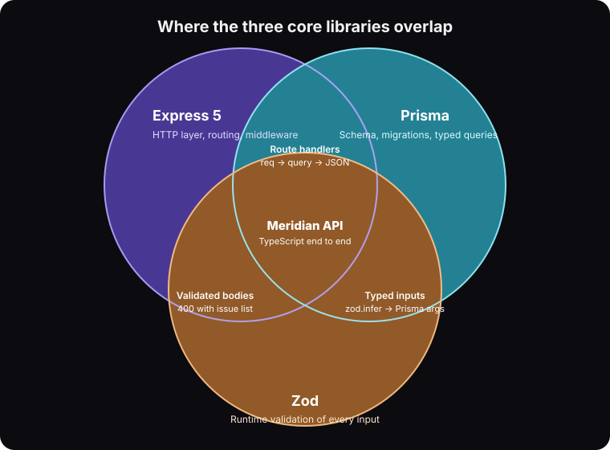
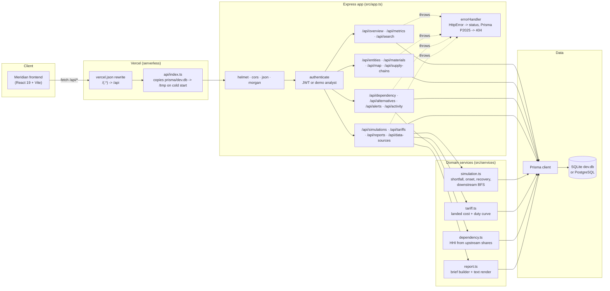
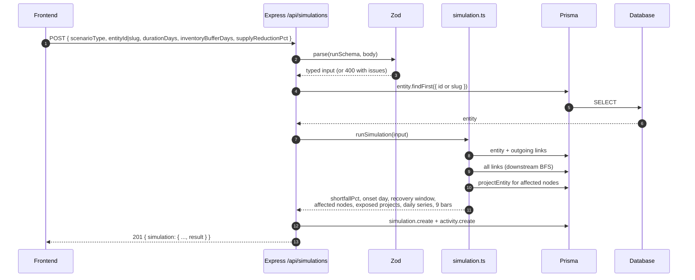
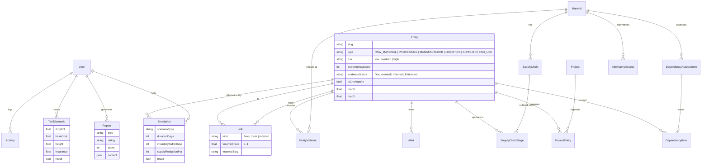
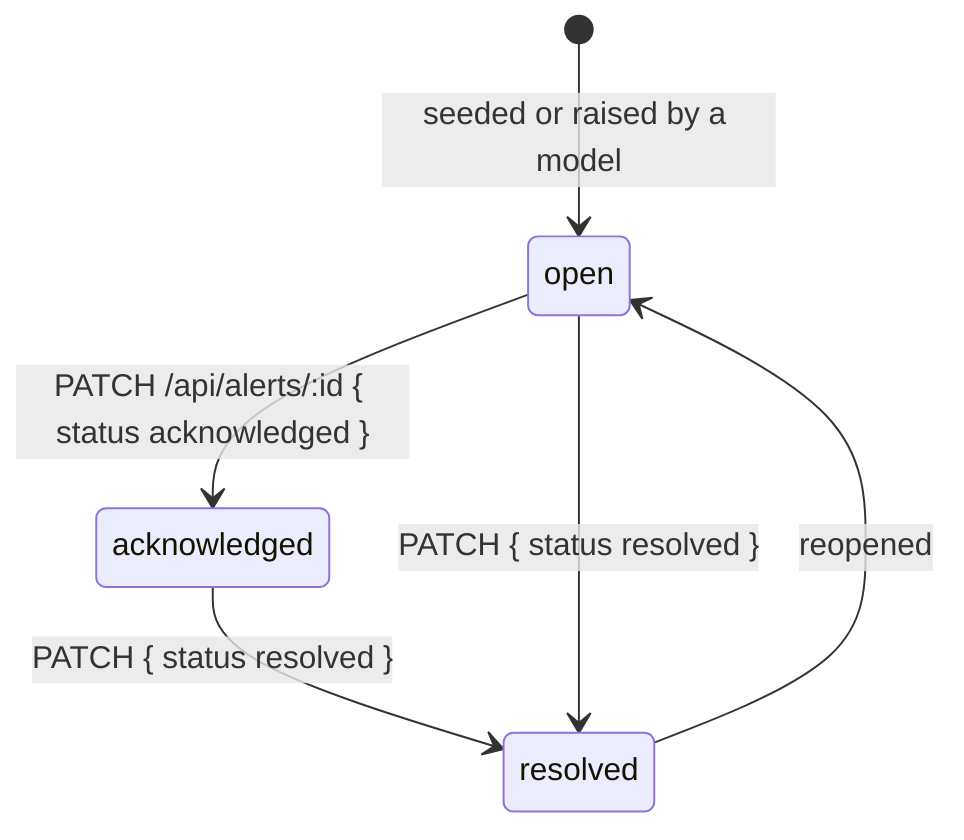
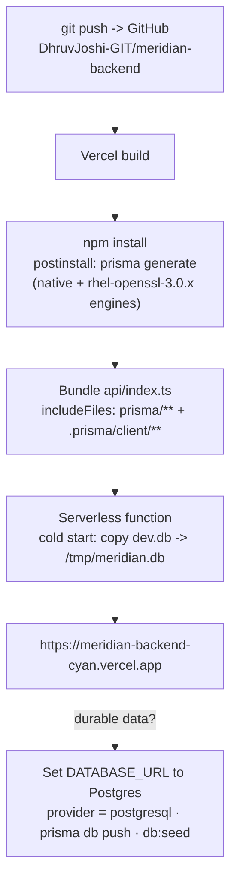
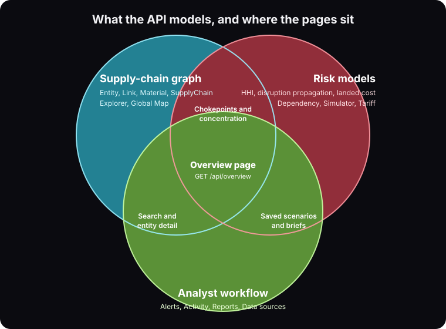

# Meridian Supply Chain Intelligence · Backend

REST API behind the Meridian analyst workspace: trace critical materials from origin to end use, score supplier concentration, simulate disruptions, model tariff impact, and generate decision briefs.

**Live API:** https://meridian-backend-cyan.vercel.app · **Health:** https://meridian-backend-cyan.vercel.app/api/health · **One-call overview:** https://meridian-backend-cyan.vercel.app/api/overview

Built from a Figma Make frontend ([Build Meridian Supply Chain Intelligence](https://www.figma.com/make/r5qDau9VcXwLoOlmXBcdKY/Build-Meridian-Supply-Chain-Intelligence)): every number the UI shows has an endpoint here, and the Simulator, Tariff and Reports pages run on real calculations instead of hardcoded values.

---

## Tech stack

| Layer | Choice | Why |
| --- | --- | --- |
| Runtime | **Node.js 22+**, **TypeScript 5** | One language with the frontend, strict types end to end |
| HTTP | **Express 5** | Async handlers with native error propagation, tiny surface |
| ORM | **Prisma 6** | Schema as source of truth, typed queries, one-line database swap |
| Database | **SQLite** (dev + demo) / **PostgreSQL** (production) | Zero setup locally; change `provider` and `DATABASE_URL` to move |
| Validation | **Zod 4** | Every body and query string is parsed before it touches a query |
| Auth | **JSON Web Tokens** + **bcryptjs** | Stateless sessions; demo-analyst fallback while the UI has no login |
| Hardening | **helmet**, **cors**, **morgan** | Security headers, origin allow-list, request logs |
| Dev loop | **tsx** | Run TypeScript directly, with watch mode |
| Hosting | **Vercel** serverless | `api/index.ts` wraps the Express app; `vercel.json` rewrites every path to it |

<p align="center"></p>

---

## Architecture



### Request flow: running a disruption scenario



### Data model



### Alert lifecycle



### Deployment pipeline



<p align="center"></p>

---

## Quick start (local)

```bash
git clone https://github.com/DhruvJoshi-GIT/meridian-backend.git
cd meridian-backend
cp .env.example .env
npm run setup     # install, generate Prisma client, create dev.db, seed demo data
npm run dev       # http://localhost:4000
```

Demo login: `alex.morgan@meridian.local` / `meridian123`

`AUTH_REQUIRED=false` (the default) means requests without a token act as the seeded demo analyst, so the UI works before a login screen exists. Set it to `true` to require `Authorization: Bearer <token>` on every `/api` route except `/api/auth/*` and `/api/health`.

Other scripts: `npm run db:reset` (wipe and reseed), `npm run db:studio` (Prisma GUI), `npm run typecheck`, `npm run build && npm start`.

### Moving to Postgres

Change `provider = "sqlite"` to `"postgresql"` in `prisma/schema.prisma`, set `DATABASE_URL`, then `npx prisma db push && npm run db:seed`. No application code changes.

### Deploying to Vercel

```bash
npm i -g vercel
vercel link
vercel env add JWT_SECRET production      # any long random string
vercel env add AUTH_REQUIRED production   # false for the public demo
vercel env add CORS_ORIGIN production     # * or a comma-separated allow-list
vercel --prod
```

The repo ships `prisma/dev.db` (seeded) so the demo runs with no database service. On Vercel the file is copied to `/tmp` per function instance: reads are instant, writes survive until the instance recycles.

---

## API

All responses are JSON. Errors: `{ "error": string, "details"?: any }` with 400 / 401 / 404 / 409 / 500.

### Auth
| Method | Path | Body | Notes |
|---|---|---|---|
| POST | `/api/auth/login` | `{email, password}` | Returns `{token, user}` |
| POST | `/api/auth/register` | `{email, password, name, title?}` | 201 `{token, user}` |
| GET | `/api/auth/me` | | Current user |

### Overview page
| Method | Path | Notes |
|---|---|---|
| GET | `/api/overview` | Greeting, `dataUpdatedLabel`, 4 metric tiles, top 3 open alerts, recent activity, map nodes. One call for the whole page. |
| GET | `/api/metrics` | The 4 KPI tiles only (counts computed from the database) |
| GET | `/api/search?q=` | Unified search: materials, entities, reports, pages. Empty `q` returns the suggestion chips. |
| GET | `/api/alerts?status=&level=&limit=` | Intelligence updates with relative `time` labels |
| PATCH | `/api/alerts/:id` | `{status: open|acknowledged|resolved}` |
| GET | `/api/activity` | Current user's recent activity |
| POST | `/api/activity` | `{type, title, refType?, refId?}` |
| GET | `/api/data-sources` | Feeds and freshness ("Data updated 12 min ago") |

### Supply Chain Explorer / Global Map
| Method | Path | Notes |
|---|---|---|
| GET | `/api/materials` | All tracked materials with connected-entity counts |
| GET | `/api/materials/:slug` | Material + entities, chains, assessments, alternatives |
| GET | `/api/entities?type=&risk=&material=&chokepoint=&q=` | Filterable node list |
| GET | `/api/entities/:idOrSlug` | Side-panel detail: materials, dependency score, evidence status, links, projects, alerts |
| GET | `/api/entities/:idOrSlug/graph?depth=` | Neighbourhood graph `{nodes, edges}` |
| GET | `/api/supply-chains?material=` | Ordered stages RAW MATERIAL to END USE |
| GET | `/api/map?material=` | Pins (`mapX/mapY` % and lat/lng), routes, layer list, legend |

### Dependency Analysis / Alternative Sources
| Method | Path | Notes |
|---|---|---|
| GET | `/api/dependency?material=gallium-nitride` | Curated assessment table plus `live` HHI computed from upstream link shares |
| GET | `/api/dependency/assessments` | All assessments |
| GET | `/api/alternatives?material=&type=` | supplier / route / recycling / substitution options |

### Disruption Simulator
| Method | Path | Notes |
|---|---|---|
| GET | `/api/simulations/options` | Scenario types, entity dropdown, defaults |
| POST | `/api/simulations` | `{scenarioType, entityId|slug, durationDays, inventoryBufferDays, supplyReductionPct, save?}` |
| GET | `/api/simulations` / `/:id` | Saved runs |
| DELETE | `/api/simulations/:id` | |

Model: `shortfall = reduction × entity supply share × scenario severity`; onset = buffer + 1 day; recovery scales with duration and shortfall; affected nodes come from a breadth-first walk of downstream links. The UI defaults (Coastal Refining, 90 days, 35-day buffer, 70 %) give 41 % from day 36 with a 121 to 165 day recovery window.

### Tariff Intelligence
| Method | Path | Notes |
|---|---|---|
| GET | `/api/tariffs/options` | Origins, destinations, products with HS codes, defaults |
| POST | `/api/tariffs/calculate` | `{dutyPct, baseCost?, freight?, insurance?, ...}` → current vs scenario landed cost, delta, 0 to 30 % curve. Stateless. |
| POST | `/api/tariffs/scenarios` | Save a scenario |
| GET | `/api/tariffs/scenarios` / `/:id` | |

### Reports
| Method | Path | Notes |
|---|---|---|
| GET | `/api/reports` | Saved briefs with rank, rating, score |
| POST | `/api/reports/generate` | `{type?, title?, materialSlug?, simulationId?, tariffScenarioId?}` builds sections from live data |
| GET | `/api/reports/:id` | Full sections |
| GET | `/api/reports/:id/download` | Plain-text brief |

---

## Project layout

```
api/index.ts           Vercel serverless entry (copies the SQLite file to /tmp, exports the app)
prisma/schema.prisma   data model (14 tables)
prisma/seed.ts         demo data matching the Figma design
prisma/dev.db          seeded SQLite database shipped for the demo
src/app.ts             Express app + route mounting
src/index.ts           local server (npm run dev)
src/routes/*           one router per UI area
src/services/*         simulation, tariff, dependency (HHI) and report builders
src/middleware/auth.ts JWT auth with demo-user fallback
docs/*.svg             Venn diagrams used above
```

## License

MIT
